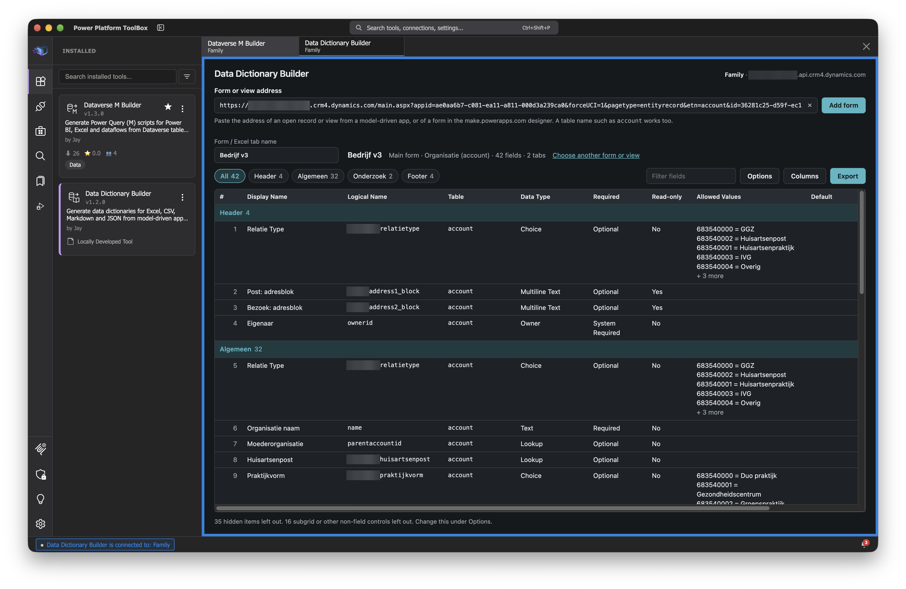

# Data Dictionary Builder

A tool for [Power Platform ToolBox](https://www.powerplatformtoolbox.com). Paste the address of a model-driven app form or view and get a data dictionary of the fields on it: in the order they appear on screen, grouped by tab and section, with the usual data dictionary columns.



Other metadata exporters list every column of a table. This one lists what a user actually sees on one screen, which is what you need for training material, UAT scripts, migration mapping workshops and functional design documents.

## Use

1. Open the tool in ToolBox and select a connection.
2. Paste an address and press **Build dictionary**. Accepted:
   - a record address from a model-driven app (`…/main.aspx?appid=…&pagetype=entityrecord&etn=account&id=…&formid=…`)
   - a view address (`…&pagetype=entitylist&etn=account&viewid=…`)
   - a form or view designer address from make.powerapps.com
   - a table logical name (`account`) or a form/view id
3. If the address does not say which form (record addresses often leave `formid` out), pick one from the list. Forms that belong to the app in the address are marked.
4. Narrow the list with the tab buttons (select one or several; **All** clears the selection) and the filter box, choose columns, then export to Excel, CSV, Markdown or JSON, or copy the table. Exports contain the rows shown.

## Output

Rows follow the order of appearance: header, each tab left to right (sections and fields top to bottom), footer. For views, columns left to right.

| Column | Default | Notes |
| --- | --- | --- |
| #, Tab, Section, Label | on | Label is the label on the form; falls back to the column display name |
| Logical Name, Data Type, Format, Length / Range | on | |
| Required, Read-only | on | Read-only = locked on the form, or the column can never be edited |
| Allowed Values, Default, Lookup Targets | on | Choice values as `value = label` |
| Description, Custom | on | |
| Display Name, Schema Name, Table, Visible, Source, Searchable, Audited, Column Security, Control, Notes | off | Turn on under **Columns** |

Options: include hidden tabs/sections/fields, include subgrids/quick views/web resources, list each field once, one Excel worksheet per tab, label language (when the form has labels in more than one language).

The Excel workbook also has an **Allowed Values** sheet (one row per choice) and an **About** sheet (source address, environment, date, scope).

## Limits

- Reflects the saved form or view design. Business rules, scripts and security roles can show, hide or lock fields at runtime, and the tool cannot see that.
- Model-driven forms and views only. Canvas apps, custom pages, Power Pages and dashboards are not supported.
- Business process flow stages and fields inside quick view forms are not expanded (a quick view appears as one control when "include subgrids…" is on).
- Read-only: it reads form, view and column definitions, never records, and writes nothing to Dataverse.

## Requirements

Power Platform ToolBox 1.2.7 or later, with one Dataverse connection.

## AI assistance

Most of this tool's code, tests and documentation were generated with Claude (Anthropic), working from the maintainer's requirements and feedback. The maintainer directs the design, runs the tool in Power Platform ToolBox against a live Dataverse environment before each release, and is responsible for what is published. Issues and corrections are welcome.

## Develop

```bash
npm install
npm run build      # type-check and bundle into dist/
npm test           # unit tests for URL parsing, form/view parsing, dictionary rows and exports
npm run preview    # builds preview/ with mock data; open preview/index.html?demo=form in a browser
```

Load into ToolBox: Settings → Show Debug Menu, then Debug → Load Local Tool → select this folder.

## Publish

Releases are published by GitHub Actions through npm trusted publishing; no npm token is stored.

1. Set the new version in `package.json` (`npm version <x.y.z> --no-git-tag-version`), update `CHANGELOG.md`, commit and push.
2. Tag and push the tag: `git tag v<x.y.z> && git push origin v<x.y.z>`. The `publish.yml` workflow builds, tests, validates and publishes.
3. For a first submission or after a change request, submit the package name at https://www.powerplatformtoolbox.com/submit-tool

## License

MIT
